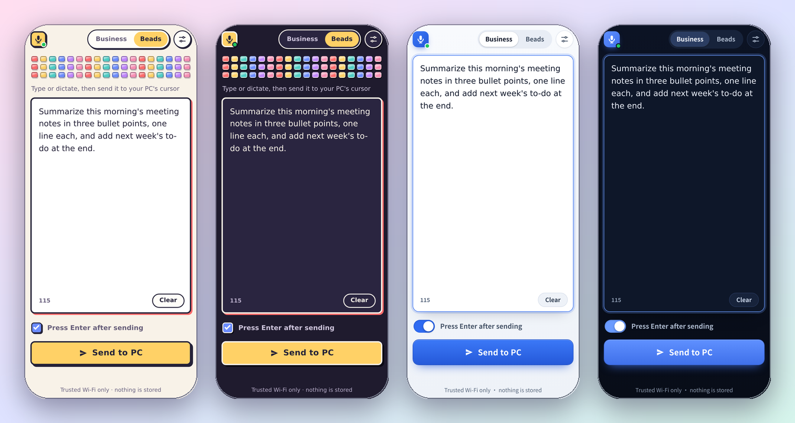
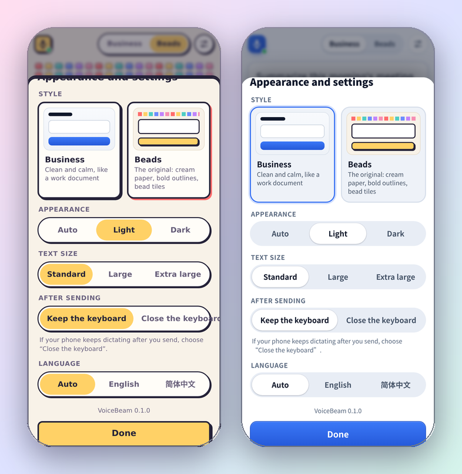
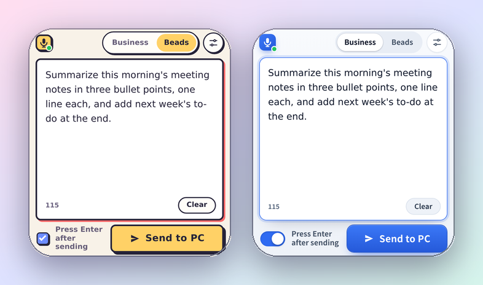

<div align="center">



# VoiceBeam

### Speak into your phone. It types on your PC.

Dictate with your phone's own voice keyboard, tap **Send**, and the text lands at the cursor of whatever window is in front on your Windows PC.<br>
**One `.bat` file. Double-click it. No install, no account, no cloud, no app on the phone.**

### [⬇ Download VoiceBeam.bat](https://github.com/unnamedfish2017/VoiceBeam/releases/latest/download/VoiceBeam.bat)

[](https://github.com/unnamedfish2017/VoiceBeam/actions/workflows/test.yml) [](https://github.com/unnamedfish2017/VoiceBeam/releases)   

**English** · [简体中文](README.zh-CN.md)

</div>

---

> ### 🎙️ Works with the voice keyboard you already use
>
> VoiceBeam is deliberately *just a big text box*: your phone's keyboard does the speech recognition, so Doubao (豆包), iFlytek, Sogou, Gboard or the system dictation all work. Tap the box → tap the keyboard's microphone → talk → glance at the text → **Send**.

## Why

Your phone's voice input is often better than anything you can run on a PC, and typing a long paragraph on a desktop keyboard is slow. VoiceBeam connects the two: the phone is the microphone *and* the editor, the PC just receives the result — in a chat box, an editor, a terminal, a browser form, anything with a cursor.

- **One file, nothing to install.** `VoiceBeam.bat` is a few lines of cmd plus PowerShell, which Windows already has. Open it in Notepad and read it before you run it, if you like.
- **No app on the phone.** It is a web page; scan the QR code the PC shows.
- **Two looks.** *Beads* (拼豆): cream paper, bold outlines, a strip of bead tiles, a big yellow button. *Business*: calm and clean. Each in light and dark; the phone remembers its pick.
- **A big text box.** It fills the screen, and when the keyboard pops up it keeps its size and **Send** stays in reach.
- **Edit before you send.** Fix what the recogniser got wrong, then send. Nothing is typed until you tap.
- **Send ends the dictation, the keyboard stays.** After **Send** the keyboard stays up for the next sentence while the phone's voice input stops, instead of listening on into the emptied box. Tap the microphone for the next one.
- **Enter if you want it.** A switch decides whether the PC also presses Enter — handy for chat boxes and terminals.
- **Private.** No cloud, no account, no analytics, no external requests, nothing stored. [Security](SECURITY.md).

## Quick start

You need a Windows 10 or 11 PC and a phone on the **same Wi-Fi**.

1. **[Download VoiceBeam.bat](https://github.com/unnamedfish2017/VoiceBeam/releases/latest/download/VoiceBeam.bat)** and double-click it.
   Windows may ask before running a file from the internet: choose **More info → Run anyway** (or right-click the file → Properties → **Unblock**). If the firewall asks, allow **private networks**.
2. Scan the QR code in the window with your phone's camera (or type the `Phone URL` it prints).
3. Click where you want the text on the PC, dictate on the phone, tap **Send**.

Press **Ctrl+C** in the window to stop.

## Two looks



Tap the **Business | Beads** switch at the top for the style, or ⚙ for light/dark, text size, what the keyboard does after sending, and the language (English and 简体中文 so far; a language is [one JSON file](web/locales)).

| | Business | Beads (拼豆) |
| --- | --- | --- |
| Feel | Calm, flat, a work document | Cream paper, bold ink outlines, hard shadows |
| Details | Hairline borders, one blue accent | A strip of 54 bead tiles in six colours, a yellow **Send** button that presses in, a blue check box, a coral shadow on the text box while you type |
| Feedback | The button turns green | The button turns teal and the bead tiles hop one after another |
| Dark | Deep navy | Ink-blue paper with cream outlines |

Both are pure CSS: no image files, no fonts to download, nothing from the internet.

## A text box that stays big

| | A plain page | VoiceBeam |
| --- | --- | --- |
| Type size | 18 px | 18 px, or 22 / 26 px in ⚙ |
| Box height on a 390×844 phone | 164 px | **~430–525 px** — it fills the screen |
| Box height with the keyboard up (440 px of the screen left) | 164 px | **~260 px**, and **Send** is still on screen |



When the keyboard takes half the screen, the decoration steps aside (the bead strip, the hint, the footer) and the switch and **Send** share one row.

## How it works

```text
phone browser ──► http://<your PC>:8123/ ──► VoiceBeam.bat (PowerShell) ──► clipboard + Ctrl+V (+ Enter) ──► the window in front
```

1. The `.bat` starts a tiny HTTP server in PowerShell and shows a QR code for its address.
2. The page on the phone posts `{"text": "...", "append_enter": true}` to `/api/send`.
3. The PC puts the text on the clipboard, presses **Ctrl+V** in the foreground window, optionally presses **Enter**, then puts your previous *text* clipboard back. (An image or files on the clipboard are not restored.)

## Safety

There is **no login**: anyone on your Wi-Fi who opens the page can type on the PC. That is fine at home or in an office you trust, and wrong on a café or hotel network. Close VoiceBeam when you do not need it, and allow it through the firewall for **private** networks only.

What it does guard against: a web page you visit on the PC or the phone **cannot** use your browser to type on the PC — the server refuses cross-origin requests, non-JSON posts and made-up host names (the DNS-rebinding trick). Details, and what is *not* covered, in [SECURITY.md](SECURITY.md).

## Troubleshooting

- **The phone cannot open the page.** Same Wi-Fi? Some routers isolate "guest" Wi-Fi from the rest of the network. Allow VoiceBeam in the Windows firewall for private networks. With a VPN or several network adapters the QR code may carry the wrong address — type `http://<the PC's LAN address>:8123/` instead.
- **Nothing appears in my app.** The text goes to whichever window is in front *when you tap Send*, so click the target first. A program running **as administrator** ignores input from a normal program (Windows blocks it): run VoiceBeam as administrator too. Some games and remote-desktop clients ignore pasted keys.
- **The phone keeps dictating after Send.** Keyboards differ; in ⚙ set **After sending → Close the keyboard**, which stops every keyboard.
- **The window closes at once, or PowerShell is blocked.** The `.bat` starts PowerShell with a per-process `-ExecutionPolicy Bypass`, but a company policy can still forbid PowerShell. The window shows the error instead of closing.
- **The QR code does not fit the window.** VoiceBeam measures how wide the console draws a half block before drawing the code. Where it is one cell — Windows Terminal (which is where Windows 11 opens a double-clicked `.bat`) and most consoles — the code takes two modules per line, about 17 lines for a home-network address. The classic console with a Chinese, Japanese or Korean font draws it two cells wide, so there it gets full-size squares and the window is made taller. If it still comes out wrong, open a Command Prompt, run `set VOICEBEAM_QR=half` (or `full`), then start `VoiceBeam.bat` from it.
- **"Port 8123 is busy".** Another VoiceBeam is running, or something else owns the port. The next free port is used and printed.
- **The dot next to the logo is red.** The page cannot reach the PC any more (VoiceBeam stopped, the PC slept, the Wi-Fi changed). Your text stays in the box.

## Build it yourself

`VoiceBeam.bat` is generated from two parts and committed so it can be downloaded:

```text
web/            the page the phone opens (HTML, CSS, JS, one JSON file per language)
src/server.ps1  the PC side: QR code, HTTP server, request checks, clipboard + Ctrl+V
```

```powershell
powershell -ExecutionPolicy Bypass -File build.ps1        # web/ + src/server.ps1 -> VoiceBeam.bat
powershell -ExecutionPolicy Bypass -File tests/run.ps1    # checks the file and the real server
```

The tests start the real server inside the `.bat` (only the final paste is replaced by a stub) and check the page, the API and every security check. GitHub Actions runs them on Windows PowerShell 5.1, PowerShell 7 and Linux. More in [CONTRIBUTING.md](CONTRIBUTING.md).

## Community

- [Linux.Do](https://linux.do/) — Share, discuss, and follow development with the community.

## License

[MIT](LICENSE)
