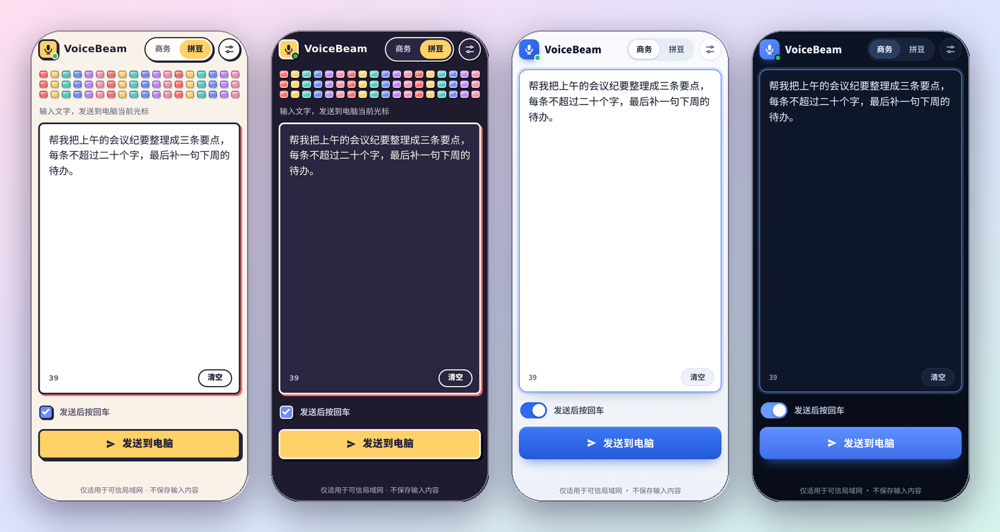
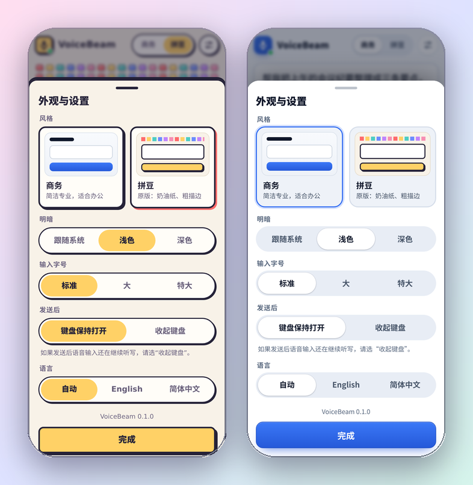
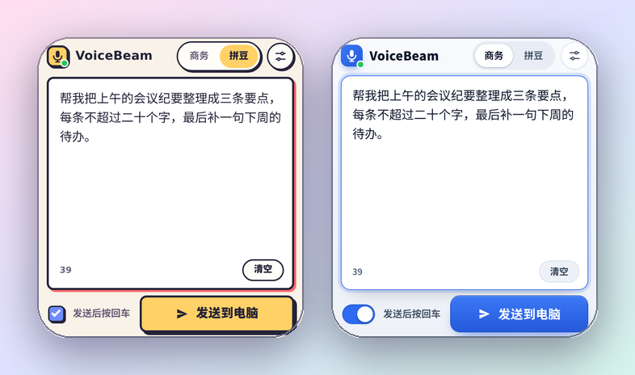

<div align="center">



# VoiceBeam

### 说啥打啥：手机开口，电脑落字

用手机自带的语音输入法说话，点一下**发送**，文字就落在 Windows 电脑当前窗口的光标处。<br>
**一个 `.bat` 文件，双击就用。不用安装，不用注册，不走云端，手机上也不用装 App。**

### [⬇ 下载 VoiceBeam.bat](https://github.com/unnamedfish2017/VoiceBeam/releases/latest/download/VoiceBeam.bat)

[](https://github.com/unnamedfish2017/VoiceBeam/actions/workflows/test.yml) [](https://github.com/unnamedfish2017/VoiceBeam/releases)   

[English](README.md) · **简体中文**

</div>

---

> ### 🎙️ 配豆包输入法的语音输入最顺手
>
> VoiceBeam 故意做成*一个大文本框*：语音识别全交给手机键盘，所以豆包、讯飞、搜狗、Gboard、系统听写都能用。作者每天用的是**豆包输入法**。
> 点一下文本框 → 点键盘上的话筒 → 说话 → 扫一眼文字 → **发送**。就这么简单。

## 为什么做它

手机上的语音输入往往比电脑上任何方案都准，而在电脑上敲一大段字又慢。VoiceBeam 把两者接起来：手机是话筒，也是编辑器；电脑只负责接收结果——聊天框、编辑器、终端、网页表单，只要有光标就行。

- **一个文件，什么都不用装。** `VoiceBeam.bat` 是几行 cmd 加一段 PowerShell，而 PowerShell 是 Windows 自带的。不放心的话，运行前可以先用记事本打开看一遍。
- **手机上不用装 App。** 它就是一个网页，扫电脑上显示的二维码即可。
- **两种风格。** *拼豆*：奶油色纸面、粗描边、一排方块拼豆、黄色大按钮；*商务*：沉稳干净。每种都有浅色和深色，手机会记住你的选择。
- **文本框很大。** 它占满屏幕；键盘弹起时依然保持大小，**发送**按钮也不会被挡住。
- **发送前可以改。** 识别错了就改一改再发，点发送之前电脑上不会出现任何字。
- **发送就结束这一段语音，键盘留着。** 点**发送**后键盘不收起，方便接着说下一句；手机的语音输入会停下，不会对着清空的输入框继续听写，再点话筒才开始下一段。
- **要不要回车，你说了算。** 一个开关决定电脑是否同时按下回车（聊天框、终端很常用）。
- **私密。** 没有云、没有账号、没有统计、没有任何外部请求，不保存内容。[安全说明](SECURITY.md)。

## 快速开始

需要一台 Windows 10 或 11 电脑，以及和它连着**同一个 Wi-Fi** 的手机。

1. **[下载 VoiceBeam.bat](https://github.com/unnamedfish2017/VoiceBeam/releases/latest/download/VoiceBeam.bat)**，双击运行。
   Windows 运行从网上下载的文件前可能会提示：点**更多信息 → 仍要运行**（或者右键文件 → 属性 → 勾选**解除锁定**）。如果弹出防火墙提示，请允许**专用网络**。
2. 用手机相机扫窗口里的二维码（或者手动输入窗口里打印的 `Phone URL`）。
3. 在电脑上点一下想输入文字的位置，在手机上说话，点**发送**。

在窗口里按 **Ctrl+C** 即可停止。

## 两种风格



点顶部的**商务 | 拼豆**切换风格；点 ⚙ 可以设置浅色/深色、输入字号、发送后键盘怎么办，以及语言（目前有简体中文和 English，加一种语言只需要[一个 JSON 文件](web/locales)）。

| | 商务 | 拼豆 |
| --- | --- | --- |
| 感觉 | 沉稳、扁平，像一份工作文档 | 奶油色纸面、粗墨色描边、硬阴影 |
| 细节 | 细边框、一个蓝色强调色 | 一排 54 颗六色方块拼豆，能按下去的黄色**发送**键，蓝色勾选框，输入时文本框出现珊瑚红阴影 |
| 反馈 | 按钮变绿 | 按钮变成青绿色，拼豆依次跳起 |
| 深色 | 深海军蓝 | 墨蓝纸面配奶油色描边 |

两种风格都是纯 CSS：没有图片文件、不用下载字体、不访问互联网。

## 文本框始终很大

| | 朴素页面 | VoiceBeam |
| --- | --- | --- |
| 字号 | 18 px | 18 px，在 ⚙ 里可调到 22 / 26 px |
| 390×844 手机上的文本框高度 | 164 px | **约 430–525 px**，占满屏幕 |
| 键盘弹起、只剩 440 px 屏幕时 | 164 px | **约 260 px**，**发送**依然看得见 |



键盘占掉半个屏幕时，装饰（拼豆条、提示行、页脚）会先让位，开关和**发送**并排在一行。

## 工作原理

```text
手机浏览器 ──► http://<你的电脑>:8123/ ──► VoiceBeam.bat（PowerShell） ──► 剪贴板 + Ctrl+V（+ 回车） ──► 当前窗口
```

1. `.bat` 用 PowerShell 启动一个很小的 HTTP 服务，并显示它地址的二维码。
2. 手机上的页面向 `/api/send` 提交 `{"text": "...", "append_enter": true}`。
3. 电脑把文字放进剪贴板，在前台窗口按 **Ctrl+V**，按需再按**回车**，然后把你原来的*文本*剪贴板放回去（剪贴板里如果是图片或文件，则不会恢复）。

## 安全

**没有登录**：同一个 Wi-Fi 里任何人打开页面，都能在这台电脑上输入文字。在家里、在你信任的办公室没问题；在咖啡馆、酒店的网络里就不合适了。不用时关掉 VoiceBeam，并且只在防火墙里允许它走**专用网络**。

它防得住的：你在电脑或手机上访问的**其他网页，没法借你的浏览器**在这台电脑上打字（服务端会拒绝跨站请求、非 JSON 的请求，以及伪造的主机名——也就是 DNS 重绑定那一招）。具体做了什么、*没*覆盖什么，见 [SECURITY.md](SECURITY.md)。

## 常见问题

- **手机打不开页面。** 是不是同一个 Wi-Fi？有的路由器会把“访客 Wi-Fi”和其余网络隔离。请在 Windows 防火墙里允许 VoiceBeam 走专用网络。开了 VPN 或者电脑有多块网卡时，二维码里的地址可能不对，请手动输入 `http://<电脑的局域网地址>:8123/`。
- **文字没出现在我的软件里。** 文字会进入你*点发送那一刻*处于最前面的窗口，所以请先点一下目标位置。**以管理员身份运行**的程序不接受普通程序发来的输入（Windows 的限制），这种情况请也用管理员身份运行 VoiceBeam。个别游戏和远程桌面客户端会忽略粘贴的按键。
- **发送后手机还在继续听写。** 各家输入法表现不同，在 ⚙ 里把**发送后**设为**收起键盘**，这样所有输入法都会停。
- **窗口一闪而过，或者 PowerShell 被禁用。** `.bat` 会用仅对本进程生效的 `-ExecutionPolicy Bypass` 启动 PowerShell，但公司策略仍可能禁止 PowerShell。出错时窗口会停住显示错误，不会直接关掉。
- **二维码显示不全。** VoiceBeam 画码前会先实测控制台把半格字符画成几格宽。如果是一格宽（Windows Terminal，也就是 Windows 11 双击 `.bat` 时打开的窗口，以及大多数控制台），二维码按一行两个模块来画，家庭网络地址大约 17 行。经典控制台配中文、日文、韩文字体时会画成两格宽，那里改用整格色块，并把窗口拉高到放得下。如果还是不对，打开命令提示符，先运行 `set VOICEBEAM_QR=half`（或 `full`），再从这个窗口里启动 `VoiceBeam.bat`。
- **提示“端口 8123 已被占用”。** 可能已经开了另一个 VoiceBeam，或者别的程序占着。会自动换成下一个空闲端口并打印出来。
- **logo 旁边的小圆点是红色。** 页面连不上电脑了（VoiceBeam 停了、电脑睡眠了、Wi-Fi 变了）。你输入的文字仍然留在框里。

## 自己构建

`VoiceBeam.bat` 由两部分生成，生成好的文件也提交在仓库里，方便直接下载：

```text
web/            手机打开的页面（HTML、CSS、JS，每种语言一个 JSON 文件）
src/server.ps1  电脑这一端：二维码、HTTP 服务、请求检查、剪贴板 + Ctrl+V
```

```powershell
powershell -ExecutionPolicy Bypass -File build.ps1        # web/ + src/server.ps1 -> VoiceBeam.bat
powershell -ExecutionPolicy Bypass -File tests/run.ps1    # 检查文件本身和真实运行的服务端
```

测试会真的启动 `.bat` 里的服务端（只有最后“粘贴到前台窗口”那一步换成了桩），逐项检查页面、接口和每一条安全检查。GitHub Actions 会在 Windows PowerShell 5.1、PowerShell 7 和 Linux 上运行它们。更多见 [CONTRIBUTING.md](CONTRIBUTING.md)。

## 社区

- [Linux.Do](https://linux.do/) — 与社区一起分享、讨论、关注开发进展。

## 许可证

[MIT](LICENSE)
